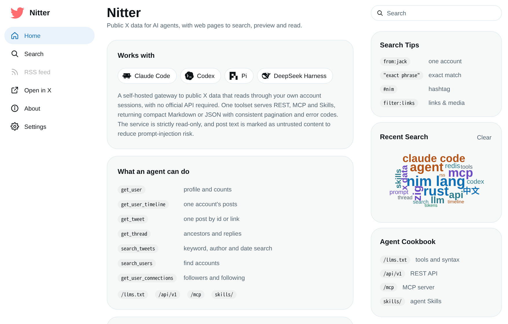

# Nitter Agent API

**English** | [简体中文](README.zh-CN.md)

A self-hosted, read-only gateway that lets AI agents read public X (Twitter)
data. One set of tools is served over **REST**, **MCP** and agent **Skills**,
and Nitter's web front-end stays alongside it for people.



```
 agent (Claude Code, Codex, pi, DeepSeek Harness, ...)
   │  MCP (Streamable HTTP)  /  REST  /  Skills
   ▼
 Nitter Agent API ──► Redis cache ──► X (your own account sessions)
```

## What it does

Seven read-only tools, available through `POST /mcp` and `/api/v1/...`:

| Tool | Purpose |
|---|---|
| `get_user` | Profile and counts |
| `get_user_timeline` | One account's tweets, replies, media or articles |
| `get_tweet` | One tweet, by id or URL |
| `get_thread` | A tweet with its ancestors, continuation and replies |
| `search_tweets` | Keyword, author and date search |
| `search_users` | Find accounts |
| `get_user_connections` | Followers and following |

- **Built for agents.** Compact Markdown output by default, JSON on request,
  uniform pagination, stable error codes, and tweet text fenced as untrusted
  content to blunt prompt injection.
- **Read-only.** There is no write, post or DM tool.
- **Your own X sessions.** It reads X's web endpoints through the accounts you
  provide (see [docs/sessions.md](docs/sessions.md)). No official API key.
- **Protected.** Bearer tokens, per-token rate limits, Origin checks, and a
  Redis cache that keeps repeated questions off your session quota.
- **Self-describing.** `GET /api/v1/openapi.json` and `GET /llms.txt` list the
  tools for any client.
- **Disabled by default.** Without `[Api] enabled = true` the server behaves as
  the plain Nitter web front-end.

## The web pages

The same port serves a browser interface for people, in a three-column layout
(navigation rail, timeline, search and tips):

- **Themes.** X (default), Vercel, Mono, Claude, Codex and TikTok, each with a
  light and a dark palette. *Light / Dark / System* is in the Appearance menu.
- **Chinese interface.** One click switches the interface to 简体中文. Posts
  and names from X are never translated.
- **Optional extras** (on by default, plain pages work without them): a photo
  viewer, keyboard shortcuts (`?` lists them) and a word cloud of the searches
  made in your own browser. They never leave the browser.
- **No JavaScript needed, no ads, RSS feeds** for profiles, lists and searches.

Details are in [docs/web-ui.md](docs/web-ui.md).

## Quick start

```sh
git clone https://github.com/xiaoY233/nitter.git && cd nitter
docker build -t vuldocker/nitter:latest .

cp nitter.example.conf nitter.conf     # set [Api] enabled = true, redisHost = "nitter-redis"
cp /path/to/sessions.jsonl .           # X account sessions
echo "NITTER_API_TOKENS=me:$(openssl rand -hex 24)" > .env
# uncomment the `environment` block in compose.yml, then:
docker compose up -d
```

Check it:

```sh
curl http://127.0.0.1:8080/api/v1/health
curl -H "Authorization: Bearer <secret>" \
  "http://127.0.0.1:8080/api/v1/users/jack?format=markdown"
```

`<secret>` is the part of the token after the colon. Open
`http://127.0.0.1:8080` in a browser for the web pages. The full walk-through,
including building from source and systemd, is in
[docs/deployment.md](docs/deployment.md).

## Connect an agent

MCP, for example with Claude Code:

```sh
claude mcp add --transport http nitter http://<host>:8080/mcp \
  --header "Authorization: Bearer <secret>"
```

Clients that only speak stdio use the bridge in
[`clients/mcp-stdio`](clients/mcp-stdio). Skills that teach an agent how to
research with these tools are in [`skills/`](skills/README.md). Other clients
and the REST API are covered in [docs/agent-api.md](docs/agent-api.md).

## Documentation

| Document | Contents |
|---|---|
| [docs/deployment.md](docs/deployment.md) | Docker Compose, `docker run`, source build, systemd, troubleshooting |
| [docs/configuration.md](docs/configuration.md) | Every `nitter.conf` option and the environment variables |
| [docs/sessions.md](docs/sessions.md) | Account sessions, upstream and server rate limits, error meanings |
| [docs/agent-api.md](docs/agent-api.md) | Tools, REST, MCP, data notes, Skills |
| [docs/web-ui.md](docs/web-ui.md) | The X theme and the colour themes, keyboard shortcuts, the Chinese interface |
| [docs/ui-system.md](docs/ui-system.md) | Design tokens and components, for people changing the web pages |
| [skills/README.md](skills/README.md) | Installing the agent Skills |

## Notes

- Intended for a trusted network. Every call spends your X session quota, and
  X may restrict the account behind a session.
- The API reports unknown numbers (for example views on old tweets) as `null`,
  not `0`. See "Data notes" in [docs/agent-api.md](docs/agent-api.md).

## License and origin

This project is a fork of [zedeus/nitter](https://github.com/zedeus/nitter),
licensed under the [GNU AGPL v3](LICENSE). The agent API, MCP server, Skills,
themes and related changes are by the maintainers of this repository and are
released under the same license. If you offer this software over a network, the
AGPL requires you to make the source of your running version available to its
users. Theme colours come from [tweakcn](https://tweakcn.com) (Apache-2.0); the
agent logos on the home page come from LobeHub (MIT).
