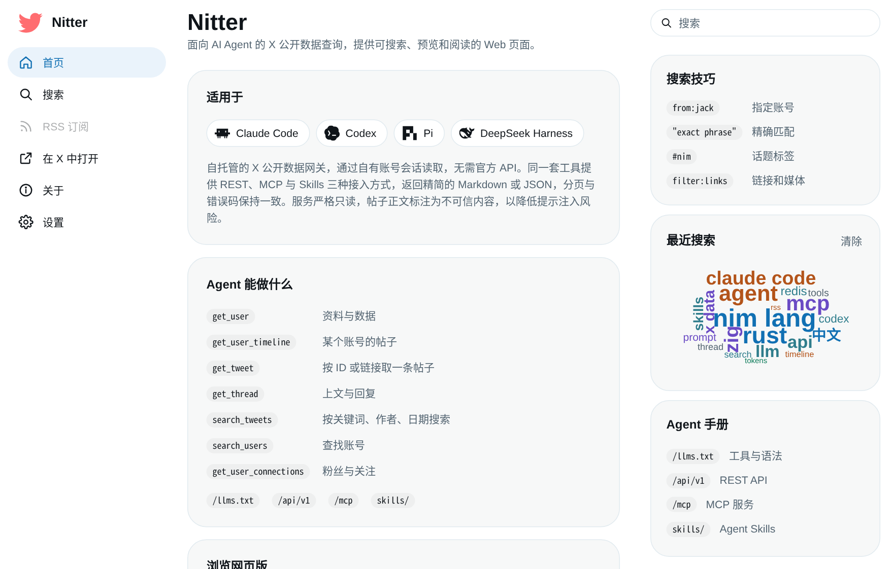

# Nitter Agent API

[English](README.md) | **简体中文**

一个自托管的只读网关，让 AI Agent 读取 X（Twitter）上的公开数据。同一套工具通过
**REST**、**MCP** 和 Agent **Skills** 三种方式提供，同时保留 Nitter 的网页界面，供人浏览。



```
 Agent（Claude Code、Codex、pi、DeepSeek Harness ……）
   │  MCP（Streamable HTTP） / REST / Skills
   ▼
 Nitter Agent API ──► Redis 缓存 ──► X（你自己的账号会话）
```

## 功能

七个只读工具，通过 `POST /mcp` 和 `/api/v1/...` 调用：

| 工具 | 用途 |
|---|---|
| `get_user` | 资料与计数 |
| `get_user_timeline` | 某个账号的推文、回复、媒体或文章 |
| `get_tweet` | 按 ID 或链接取一条推文 |
| `get_thread` | 一条推文及其上文、后续和回复 |
| `search_tweets` | 按关键词、作者、日期搜索 |
| `search_users` | 查找账号 |
| `get_user_connections` | 粉丝与关注 |

- **为 Agent 设计。** 默认输出精简的 Markdown，也可要求 JSON；分页方式统一，错误码稳定；
  推文正文被标注为不可信内容，以降低提示注入风险。
- **只读。** 没有写入、发帖或私信工具。
- **用你自己的 X 会话。** 通过你提供的账号读取 X 的网页接口（见
  [docs/sessions.md](docs/sessions.md)），不需要官方 API 密钥。
- **有防护。** Bearer 令牌、按令牌限速、Origin 检查，以及 Redis 缓存，避免重复提问消耗会话额度。
- **可自描述。** `GET /api/v1/openapi.json` 和 `GET /llms.txt` 向任何客户端列出这些工具。
- **默认关闭。** 没有设置 `[Api] enabled = true` 时，服务器就是普通的 Nitter 网页前端。
- **预构建镜像。** CI 在每次推送到 `master` 和版本标签时发布多架构镜像到
  `ghcr.io/xiaoy233/nitter`；首次发布后可能需要在设置里改为公开（见
  [docs/deployment.md](docs/deployment.md#published-images)）。

## 网页界面

同一个端口还提供给人使用的浏览器界面，三栏布局（导航栏、时间线、搜索与提示）：

- **主题。** X（默认）、Vercel、Mono、Claude、Codex 和 TikTok，每个都有浅色和深色两套配色；
  在“外观设置”菜单里选择 浅色 / 深色 / 跟随系统。
- **中文界面。** 一键切换为简体中文。来自 X 的帖子和名称不会被翻译。
- **可选增强**（默认开启，关闭后网页照常使用）：图片查看器、键盘快捷键（按 `?` 查看）、
  以及根据你在本浏览器中的搜索词生成的词云。这些数据不会离开浏览器。
- **无需 JavaScript，无广告**，个人资料、列表和搜索都提供 RSS 订阅。

详情见 [docs/web-ui.md](docs/web-ui.md)。

## 快速开始

```sh
git clone https://github.com/xiaoY233/nitter.git && cd nitter
docker build -t vuldocker/nitter:latest .
# 也可以直接用 CI 发布的镜像：docker pull ghcr.io/xiaoy233/nitter:latest

cp nitter.example.conf nitter.conf     # 设置 [Api] enabled = true、redisHost = "nitter-redis"
cp /path/to/sessions.jsonl .           # X 账号会话
echo "NITTER_API_TOKENS=me:$(openssl rand -hex 24)" > .env
# 取消 compose.yml 中 `environment` 块的注释，然后：
docker compose up -d
```

检查是否正常：

```sh
curl http://127.0.0.1:8080/api/v1/health
curl -H "Authorization: Bearer <secret>" \
  "http://127.0.0.1:8080/api/v1/users/jack?format=markdown"
```

`<secret>` 是令牌中冒号后面的部分。在浏览器中打开 `http://127.0.0.1:8080` 即可看到网页界面。
完整步骤（包括从源码构建和 systemd）见 [docs/deployment.md](docs/deployment.md)。

## 接入 Agent

通过 MCP，例如使用 Claude Code：

```sh
claude mcp add --transport http nitter http://<host>:8080/mcp \
  --header "Authorization: Bearer <secret>"
```

只支持 stdio 的客户端使用 [`clients/mcp-stdio`](clients/mcp-stdio) 中的桥接程序。
教 Agent 用这些工具做调研的 Skills 在 [`skills/`](skills/README.md)。其他客户端和 REST API
见 [docs/agent-api.md](docs/agent-api.md)。

## 文档

以下文档目前只有英文版：

| 文档 | 内容 |
|---|---|
| [docs/deployment.md](docs/deployment.md) | Docker Compose、`docker run`、源码构建、systemd、故障排查 |
| [docs/configuration.md](docs/configuration.md) | `nitter.conf` 的全部选项和环境变量 |
| [docs/sessions.md](docs/sessions.md) | 账号会话、上游与服务器限速、错误含义 |
| [docs/agent-api.md](docs/agent-api.md) | 工具、REST、MCP、数据说明、Skills |
| [docs/web-ui.md](docs/web-ui.md) | X 主题与配色主题、键盘快捷键、中文界面 |
| [docs/ui-system.md](docs/ui-system.md) | 设计令牌与组件，供修改网页界面的人参考 |
| [skills/README.md](skills/README.md) | 安装 Agent Skills |

## 注意事项

- 面向受信任的网络使用。每次调用都会消耗你的 X 会话额度，X 也可能限制会话背后的账号。
- 未知的数字（例如老推文的浏览量）在 API 中以 `null` 返回，而不是 `0`。见
  [docs/agent-api.md](docs/agent-api.md) 中的 “Data notes”。

## 许可与来源

本项目是 [zedeus/nitter](https://github.com/zedeus/nitter) 的分支，使用
[GNU AGPL v3](LICENSE) 许可。Agent API、MCP 服务器、Skills、主题及相关改动由本仓库的维护者完成，
使用同一许可。如果你通过网络提供本软件的服务，AGPL 要求你向其用户提供所运行版本的源代码。
主题配色来自 [tweakcn](https://tweakcn.com)（Apache-2.0）；首页上的 Agent 图标来自 LobeHub（MIT）。
